<!-- # 🔐 Secure Blockchain-Based Digital Evidence Management System (LEGALVAULT)


---

## 📌 Overview

**LEGALVAULT** is a **Secure Blockchain-Based Digital Evidence Management System (SBB-DEMS)** that ensures the **authenticity, security, and reliability** of digital evidence using **blockchain technology** and **AI-powered tools**.  

🔑 Key Features:  
- 📂 Upload and manage **CCTV footage, images, documents, and audio files**.  
- 🌐 Store evidence in **IPFS decentralized storage**.  
- 🔒 Record **cryptographic hashes on blockchain** to ensure immutability.  
- 🛡️ **Role-based access control (RBAC)** for law enforcement, forensic experts, and legal authorities.  
- 📜 **Immutable chain of custody logs** for complete transparency.  
- 🤖 AI-powered **image enhancement** (super-resolution, noise reduction, contrast adjustment).  

---

## 🏗️ Tech Stack

**Backend:**  
- [Node.js](https://nodejs.org/)  
- [Express.js](https://expressjs.com/)  
- [MongoDB + Mongoose](https://mongoosejs.com/)  

**Blockchain:**  
- [Ethereum](https://ethereum.org/)  
- [Hardhat](https://hardhat.org/)  
- [Ethers.js](https://docs.ethers.io/)  
- [IPFS](https://ipfs.tech/)  

**Authentication & Security:**  
- [JWT](https://jwt.io/)  
- [BCrypt](https://www.npmjs.com/package/bcrypt)  

**Other Tools:**  
- [Multer](https://github.com/expressjs/multer) (file uploads)  
- [Cloudinary](https://cloudinary.com/) (media handling)  
- [Sharp](https://sharp.pixelplumbing.com/) (image processing)  
- [Winston](https://github.com/winstonjs/winston) (logging)  
- [Nodemailer](https://nodemailer.com/) (email service)  

**Testing & Dev Tools:**  
- [Jest](https://jestjs.io/)  
- [Nodemon](https://nodemon.io/)  

---

## 🚀 Getting Started

### 1️⃣ Clone the Repository
```bash
git clone https://github.com/Piyush11204/LEGALVAULT.git
cd LEGALVAULT -->


# 🏛️ LEGALVAULT System Architecture

## 📋 Table of Contents
1. [System Overview](#system-overview)
2. [Detailed Architecture Diagram](#detailed-architecture-diagram)
3. [Moderate Architecture Diagram](#moderate-architecture-diagram)
4. [Simple Architecture Diagram](#simple-architecture-diagram)
5. [Technology Stack](#technology-stack)
6. [Security Layers](#security-layers)
7. [Data Flow](#data-flow)
8. [Deployment Architecture](#deployment-architecture)

---

## 🎯 System Overview

**LEGALVAULT** is a comprehensive Secure Blockchain-Based Digital Evidence Management System designed for legal professionals, law enforcement, and judicial authorities. The system provides secure evidence storage, real-time collaboration, AI-powered legal assistance, and blockchain-based chain of custody tracking.

### 🔑 Key Features
- **Multi-Role Authentication** (Admin, Police, Lawyer, Judge, Forensic Expert, User)
- **Blockchain-Based Evidence Integrity**
- **AI-Powered Legal Chatbot**
- **Encrypted Data Backup & Recovery**
- **Real-time Chain of Custody Tracking**
- **KYC Verification Integration**
- **Advanced Security Layers**
- **Cloud Storage with Cloudinary**
- **Legal News & Blog Management**

---

## 🏗️ Detailed Architecture Diagram

```mermaid
graph TB
    subgraph "Frontend Layer"
        FE[React Frontend]
        FE --> |HTTPS/WSS| LB[Load Balancer]
    end

    subgraph "API Gateway & Security"
        LB --> |Route Requests| AG[API Gateway]
        AG --> |Rate Limiting| RL[Rate Limiter]
        RL --> |Authentication| AUTH[Auth Middleware]
        AUTH --> |Role-based Access| RBAC[Role Middleware]
        RBAC --> |Request Validation| VAL[Validation Layer]
    end

    subgraph "Application Layer"
        VAL --> |Route to Controllers| CTRL[Controllers Layer]
        
        subgraph "Controllers"
            CTRL --> AC[Auth Controller]
            CTRL --> EC[Evidence Controller]
            CTRL --> CC[Cases Controller]
            CTRL --> BC[Blog Controller]
            CTRL --> KYC[KYC Controller]
            CTRL --> CHAT[Chatbot Controller]
            CTRL --> CONT[Contact Controller]
            CTRL --> CUST[Custody Controller]
            CTRL --> ENH[Enhancement Controller]
        end

        subgraph "Chatbot AI System"
            CHAT --> NLPG[General Legal NLP]
            CHAT --> NLPA[Advanced Legal NLP]
            CHAT --> LQC[Legal Query Controller]
            CHAT --> LOC[Location Controller]
            CHAT --> DOC[Document Controller]
        end
    end

    subgraph "Business Logic Layer"
        AC --> |User Management| US[User Service]
        EC --> |Evidence Processing| ES[Evidence Service]
        KYC --> |Identity Verification| KYCS[KYC Service]
        CHAT --> |AI Processing| AIS[AI Service]
        CUST --> |Blockchain Logging| BS[Blockchain Service]
        
        subgraph "Core Services"
            US --> |Security Logging| ASS[Admin Security Service]
            ES --> |Cloud Storage| CS[Cloudinary Service]
            ES --> |Backup Management| DBS[Database Backup Service]
            AIS --> |Legal Knowledge| KB[Knowledge Base]
            BS --> |Transaction Logging| TL[Transaction Logger]
        end
    end

    subgraph "Data Layer"
        subgraph "Primary Database - MongoDB"
            US --> |Store/Retrieve| UD[(User Data)]
            ES --> |Metadata Storage| EM[(Evidence Metadata)]
            ES --> |Chain Tracking| COC[(Chain of Custody)]
            ASS --> |Security Logs| SL[(Security Logs)]
            BC --> |Content Management| BL[(Blog Data)]
            CONT --> |Messages| CD[(Contact Data)]
        end

        subgraph "Backup Systems"
            DBS --> |Encrypted Backups| EBD[(Encrypted Backup Data)]
            DBS --> |Backup Metadata| BMD[(Backup Metadata)]
            DBS --> |Full Backups| FB[(Full Backups)]
            DBS --> |Incremental Backups| IB[(Incremental Backups)]
        end
    end

    subgraph "External Services"
        CS --> |File Storage| CL[Cloudinary CDN]
        KYCS --> |Identity Verification| SB[Sandbox KYC API]
        ES --> |Email Notifications| EM[Email Service]
        BS --> |Smart Contracts| BC[Blockchain Network]
        AIS --> |Legal Data| LD[Legal Database]
    end

    subgraph "Security & Monitoring"
        subgraph "Encryption Layer"
            ENC[AES-256 Encryption]
            HASH[SHA-256 Hashing]
            JWT[JWT Tokens]
        end

        subgraph "Monitoring & Logging"
            LOG[Winston Logger]
            MON[System Monitor]
            HEALTH[Health Checker]
        end

        subgraph "Backup & Recovery"
            AUTO[Automated Backups]
            SCHED[Backup Scheduler]
            INTEG[Integrity Checker]
        end
    end

    %% Security Connections
    AUTH --> JWT
    ES --> ENC
    ES --> HASH
    DBS --> ENC
    BS --> HASH

    %% Monitoring Connections
    CTRL --> LOG
    ES --> MON
    DBS --> HEALTH

    %% Backup Connections
    DBS --> AUTO
    AUTO --> SCHED
    DBS --> INTEG

    %% External API Connections
    CS -.->|HTTPS| CL
    KYCS -.->|REST API| SB
    ES -.->|SMTP| EM
    BS -.->|Web3| BC

    %% Styling
    classDef frontend fill:#2563eb,stroke:#1d4ed8,stroke-width:2px,color:#ffffff
    classDef security fill:#dc2626,stroke:#b91c1c,stroke-width:2px,color:#ffffff
    classDef service fill:#7c3aed,stroke:#6d28d9,stroke-width:2px,color:#ffffff
    classDef database fill:#059669,stroke:#047857,stroke-width:2px,color:#ffffff
    classDef external fill:#ea580c,stroke:#c2410c,stroke-width:2px,color:#ffffff
    classDef monitoring fill:#4b5563,stroke:#374151,stroke-width:2px,color:#ffffff

    class FE,LB frontend
    class AG,RL,AUTH,RBAC,VAL,ENC,HASH,JWT security
    class US,ES,KYCS,AIS,BS,ASS,CS,DBS service
    class UD,EM,COC,SL,BL,CD,EBD,BMD,FB,IB database
    class CL,SB,EM,BC,LD external
    class LOG,MON,HEALTH,AUTO,SCHED,INTEG monitoring
```

---

## 🔒 Security-Focused Architecture Diagram

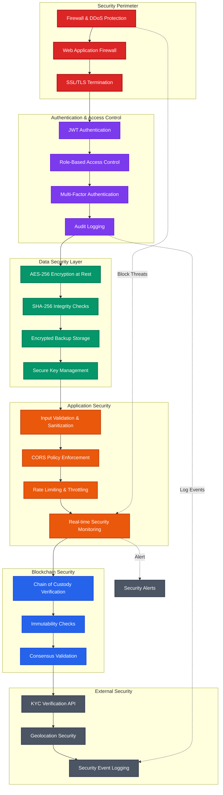

---

## 🔄 Data Flow & Integration Architecture Diagram

```mermaid
graph TB
    subgraph "User Layer"
        WEB[Web Frontend - React]
        WEB --> API[REST API Gateway]
    end

    subgraph "API Processing Layer"
        API --> AUTH[Authentication Middleware]
        AUTH --> CTRL[Request Controllers]
        CTRL --> SERV[Business Services]
    end

    subgraph "Data Storage Layer"
        SERV --> MONGO[(MongoDB Primary)]
        SERV --> IPFS[(IPFS Distributed Storage)]
        SERV --> CLOUD[(Cloudinary CDN)]
        
        subgraph "MongoDB Collections"
            MONGO --> USERS[(Users & Activity Logs)]
            MONGO --> EVIDENCE[(Evidence Metadata)]
            MONGO --> CASES[(Case Management)]
            MONGO --> BACKUPS[(Encrypted Backups)]
            MONGO --> AUDIT[(Security Audit Logs)]
        end
        
        subgraph "IPFS Storage"
            IPFS --> FILES[(Evidence Files)]
            IPFS --> DOCS[(Legal Documents)]
            IPFS --> MEDIA[(Media Assets)]
        end
    end

    subgraph "External Integrations"
        SERV --> BLOCKCHAIN[Ethereum Blockchain]
        SERV --> KYC[Sandbox KYC API]
        SERV --> EMAIL[Email Service]
        SERV --> INDIAN_KANOON[Indian Kanoon Live Cases API]
        SERV --> MAPS[Google Maps API]
        
        subgraph "Activity Logging"
            BLOCKCHAIN --> COC_LOG[Chain of Custody Logs]
            KYC --> KYC_LOG[KYC Activity Logs]
            INDIAN_KANOON --> CASE_LOG[Case Access Logs]
            EMAIL --> EMAIL_LOG[Communication Logs]
        end
    end

    subgraph "Background Services"
        SERV --> ENHANCE[AI Enhancement Jobs]
        SERV --> BACKUP_JOB[Automated Backup Jobs]
        SERV --> MONITOR[Health Monitoring]
        SERV --> ALERT[Alert System]
    end

    %% Data Flow Connections
    WEB -.->|HTTPS Requests| API
    API -.->|JWT Tokens| AUTH
    CTRL -.->|Business Logic| SERV
    SERV -.->|CRUD Operations| MONGO
    SERV -.->|File Storage| IPFS
    SERV -.->|Media Processing| CLOUD
    SERV -.->|External APIs| BLOCKCHAIN
    SERV -.->|Identity Verification| KYC
    SERV -.->|Live Case Data| INDIAN_KANOON
    SERV -.->|Location Services| MAPS
    SERV -.->|Notifications| EMAIL

    %% Activity Logging Flow
    USERS -.->|User Activities| AUDIT
    EVIDENCE -.->|Evidence Actions| COC_LOG
    CASES -.->|Case Activities| CASE_LOG
    BACKUPS -.->|Backup Activities| AUDIT

    %% Styling
    classDef user fill:#2563eb,stroke:#1d4ed8,stroke-width:2px,color:#ffffff
    classDef api fill:#7c3aed,stroke:#6d28d9,stroke-width:2px,color:#ffffff
    classDef storage fill:#059669,stroke:#047857,stroke-width:2px,color:#ffffff
    classDef mongodb fill:#10b981,stroke:#059669,stroke-width:2px,color:#ffffff
    classDef ipfs fill:#f59e0b,stroke:#d97706,stroke-width:2px,color:#ffffff
    classDef external fill:#ea580c,stroke:#c2410c,stroke-width:2px,color:#ffffff
    classDef logging fill:#6b7280,stroke:#4b5563,stroke-width:2px,color:#ffffff
    classDef background fill:#4b5563,stroke:#374151,stroke-width:2px,color:#ffffff

    class WEB user
    class API,AUTH,CTRL,SERV api
    class MONGO,CLOUD storage
    class USERS,EVIDENCE,CASES,BACKUPS,AUDIT mongodb
    class IPFS,FILES,DOCS,MEDIA ipfs
    class BLOCKCHAIN,KYC,EMAIL,INDIAN_KANOON,MAPS external
    class COC_LOG,KYC_LOG,CASE_LOG,EMAIL_LOG logging
    class ENHANCE,BACKUP_JOB,MONITOR,ALERT background
```

---

## 🏢 Moderate Architecture Diagram

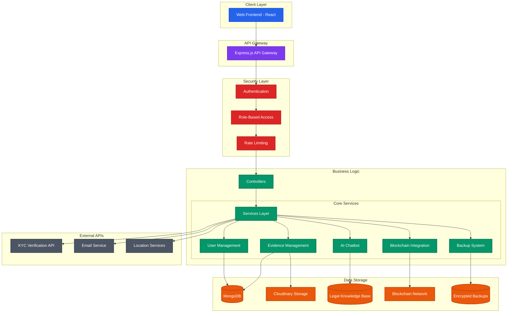

---

## 📱 Simple Architecture Diagram

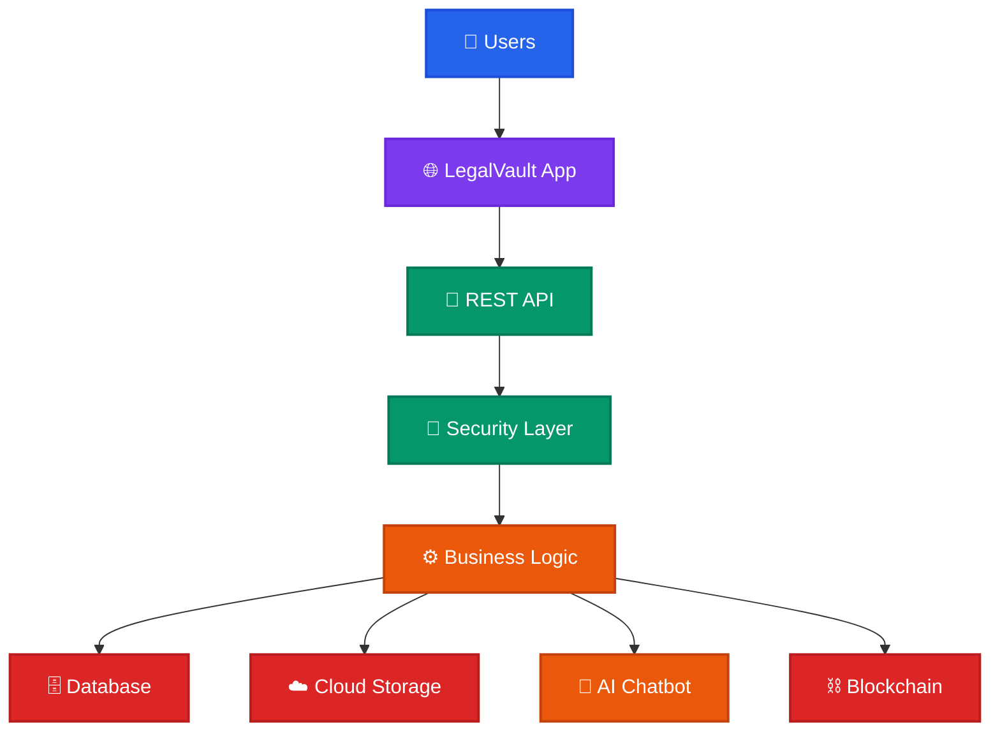

---

## 🛠️ Technology Stack

### **Frontend**
```javascript
// Frontend Technologies
{
  "framework": "React 18",
  "styling": "CSS3 + Tailwind CSS",
  "stateManagement": "React Hooks",
  "routing": "React Router DOM",
  "httpClient": "Axios",
  "bundler": "Vite",
  "icons": "Lucide React"
}
```

### **Backend**
```javascript
// Backend Technologies
{
  "runtime": "Node.js",
  "framework": "Express.js 5.1.0",
  "database": "MongoDB 8.18.1",
  "authentication": "JWT + bcrypt",
  "fileUpload": "Multer 2.0.2",
  "imageProcessing": "Sharp 0.34.3",
  "logging": "Winston 3.17.0",
  "validation": "Joi 18.0.1",
  "cors": "CORS 2.8.5",
  "rateLimiting": "express-rate-limit 8.1.0"
}
```

### **Security & Encryption**
```javascript
// Security Stack
{
  "encryption": "AES-256-CBC",
  "hashing": "SHA-256 + bcrypt",
  "authentication": "JWT Bearer Tokens",
  "authorization": "Role-Based Access Control (RBAC)",
  "apiSecurity": "Rate Limiting + CORS",
  "dataProtection": "Field-level encryption",
  "backup": "Encrypted automated backups"
}
```

### **External Services**
```javascript
// External Integrations
{
  "cloudStorage": "Cloudinary 2.7.0",
  "blockchain": "Ethereum/Sepolia + Hardhat 3.0.4",
  "smartContracts": "Ethers.js 6.15.0",
  "kycVerification": "Sandbox KYC API",
  "emailService": "Nodemailer 7.0.6",
  "locationServices": "Google Maps API",
  "legalCaseDatabase": "Indian Kanoon API",
  "activityLogging": "External API logging for user activities",
  "testing": "Jest 30.1.3"
}
```

---

## 🛡️ Security Layers

### **1. Network Security**
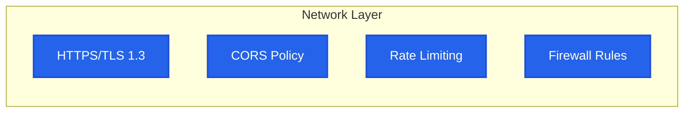

### **2. Authentication & Authorization**
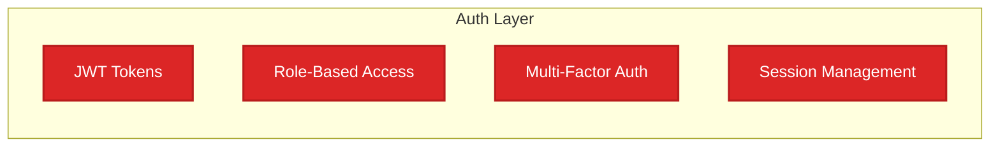

### **3. Data Security**
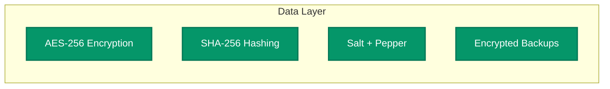

### **4. Application Security**
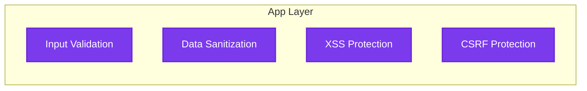

---

## 🔄 Data Flow Architecture

### **Evidence Upload Flow**
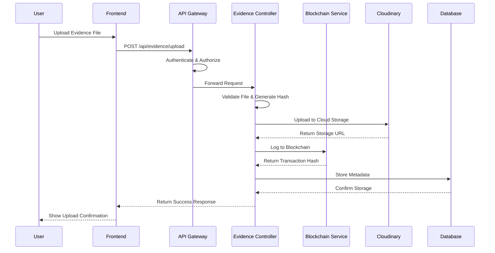

### **KYC Verification Flow**
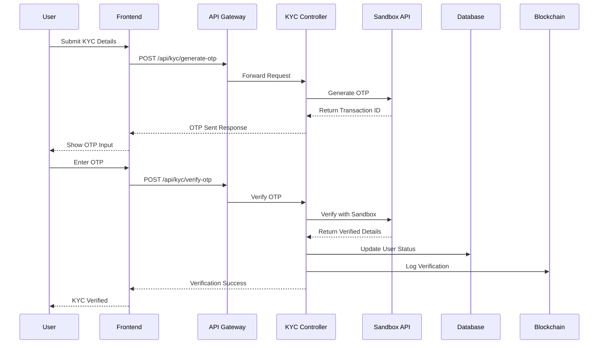

---

## 🏗️ Database Schema Architecture

### **Core Collections**
```javascript
// MongoDB Collections Structure
{
  users: {
    _id: "ObjectId",
    email: "String (unique)",
    password: "String (hashed)",
    role: "Enum [admin, police, lawyer, judge, forensic_expert, user]",
    kycStatus: "Enum [verified, pending, rejected, expired]",
    activityLog: "Array of activity objects",
    roleHistory: "Array of role change history",
    adminNotes: "Array of admin notes"
  },
  
  evidencemetadata: {
    evidenceId: "String (blockchain generated)",
    hash: "String (SHA-256)",
    cloudinaryPublicId: "String",
    cloudinaryUrl: "String",
    uploaderId: "ObjectId (ref: User)",
    fileType: "String",
    status: "Enum [pending, approved, archived]",
    metadata: "Object (GPS, EXIF, etc.)"
  },
  
  chainofcustody: {
    evidenceId: "String",
    actionId: "String (blockchain tx hash)",
    userId: "ObjectId (ref: User)",
    action: "Enum [upload, view, enhance, delete]",
    timestamp: "Date",
    details: "Object"
  },
  
  adminsecuritylogs: {
    adminId: "ObjectId (ref: User)",
    action: "String",
    targetUserId: "ObjectId (ref: User)",
    details: "Object",
    timestamp: "Date",
    ipAddress: "String",
    severity: "Enum [low, medium, high, critical]"
  },
  
  backupdata: {
    backupId: "String (unique)",
    type: "Enum [full, incremental]",
    encryptedData: "String (Base64)",
    iv: "String (encryption IV)",
    metadata: "Object",
    expiresAt: "Date (TTL)"
  }
}
```

---

## 🚀 Deployment Architecture

### **Production Environment**
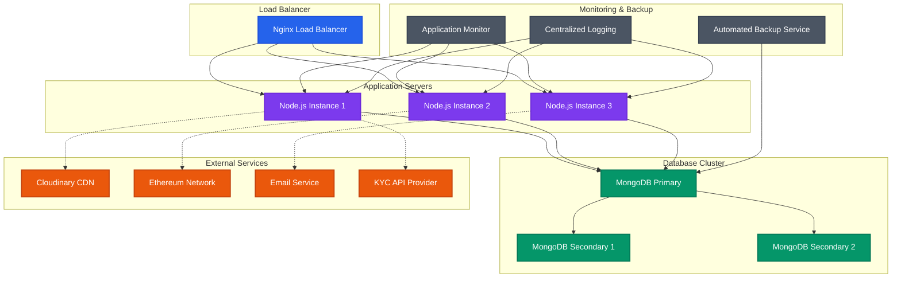

---

## 📊 Performance & Scalability

### **Horizontal Scaling Strategy**
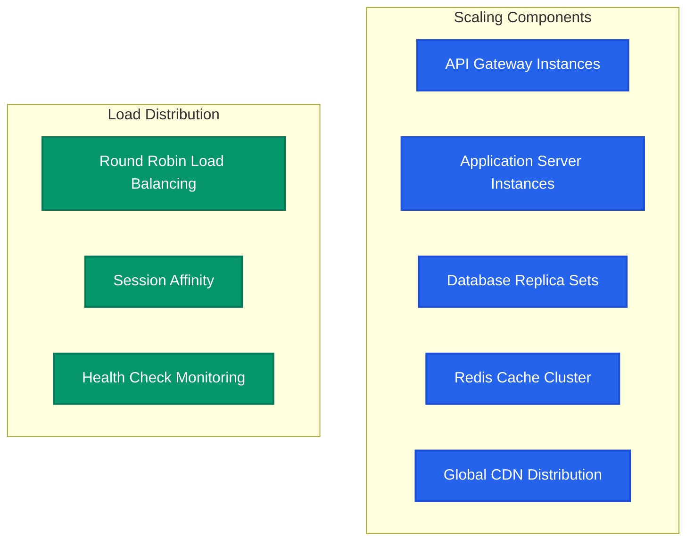

### **Caching Strategy**
```javascript
// Caching Implementation
{
  "applicationCache": {
    "type": "In-Memory + Redis",
    "ttl": "15 minutes for user data",
    "strategy": "Cache-aside pattern"
  },
  "databaseCache": {
    "type": "MongoDB built-in caching",
    "indexing": "Compound indexes on frequently queried fields"
  },
  "staticAssets": {
    "type": "Cloudinary CDN",
    "caching": "Global edge locations"
  }
}
```

---

## 🔧 API Documentation Structure

### **Core API Endpoints**
```javascript
// API Route Structure
{
  "/api/auth": {
    "POST /register": "User registration with role assignment",
    "POST /login": "JWT-based authentication",
    "GET /profile": "Get authenticated user profile",
    "PUT /profile": "Update user profile information"
  },
  
  "/api/evidence": {
    "POST /upload": "Upload evidence with blockchain logging",
    "GET /": "List user's evidence with filtering",
    "GET /:id": "Get specific evidence details",
    "PUT /:id/enhance": "AI-powered evidence enhancement",
    "DELETE /:id": "Secure evidence deletion"
  },
  
  "/api/cases": {
    "POST /": "Create new legal case",
    "GET /": "List cases with role-based filtering",
    "GET /:id": "Get case details and timeline",
    "PUT /:id": "Update case information",
    "DELETE /:id": "Archive case"
  },
  
  "/api/kyc": {
    "POST /generate-otp": "Generate OTP for KYC verification",
    "POST /verify-otp": "Verify OTP and complete KYC",
    "GET /status": "Check KYC verification status"
  },
  
  "/api/chatbot": {
    "POST /chat": "AI-powered legal assistance chat",
    "GET /history": "Chat conversation history",
    "POST /feedback": "Provide chatbot response feedback"
  },
  
  "/api/backup": {
    "POST /create": "Create manual backup (admin only)",
    "GET /list": "List available backups",
    "POST /restore": "Restore from backup",
    "GET /status": "Backup system status"
  }
}
```

---

## 🧪 Testing Architecture

### **Testing Strategy**
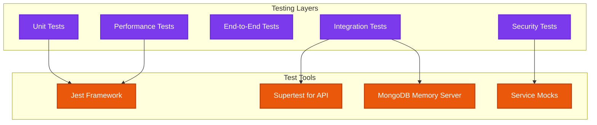

### **Test Coverage Areas**
```javascript
// Testing Coverage
{
  "unitTests": {
    "controllers": "85% coverage",
    "services": "90% coverage",
    "utilities": "95% coverage",
    "middlewares": "80% coverage"
  },
  "integrationTests": {
    "apiEndpoints": "Complete CRUD operations",
    "databaseOperations": "All MongoDB operations",
    "externalServices": "Mocked service integrations"
  },
  "securityTests": {
    "authenticationFlows": "JWT validation and expiry",
    "authorizationChecks": "Role-based access control",
    "inputValidation": "Malicious input protection"
  }
}
```

---

## 📈 Monitoring & Analytics

### **System Monitoring**
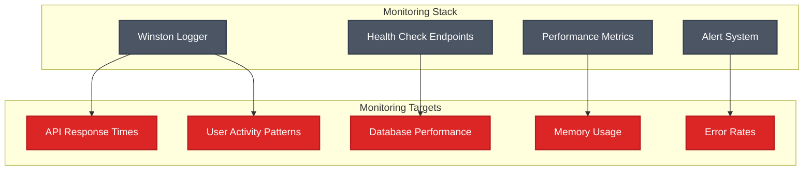

---

## 🔮 Future Enhancements

### **Planned Features**
```javascript
// Roadmap Features
{
  "phase2": {
    "multiLanguageSupport": "Hindi, Tamil, Telugu legal language processing",
    "voiceRecognition": "Audio evidence transcription",
    "documentOCR": "Automatic document text extraction",
    "advancedAnalytics": "Case outcome prediction ML models"
  },
  
  "phase3": {
    "blockchainUpgrade": "Private blockchain implementation",
    "aiEnhancement": "Advanced legal document analysis",
    "realTimeCollaboration": "WebSocket-based real-time features",
    "enhancedWebInterface": "Advanced web application features"
  },
  
  "phase4": {
    "internationalCompliance": "GDPR, CCPA compliance modules",
    "federatedSearch": "Cross-jurisdiction case search",
    "quantumSecurity": "Post-quantum cryptography preparation",
    "cloudNativeDeployment": "Kubernetes orchestration"
  }
}
```

---

## 📝 Configuration & Environment

### **Environment Variables**
```bash
# Core Configuration
NODE_ENV=production
PORT=5000
MONGO_URI=mongodb://localhost:27017/legalvault

# Security Keys
JWT_SECRET=your-super-secure-jwt-secret-key
BACKUP_ENCRYPTION_KEY=your-256-bit-backup-encryption-key

# External Service APIs
CLOUDINARY_CLOUD_NAME=your-cloudinary-cloud-name
CLOUDINARY_API_KEY=your-cloudinary-api-key
CLOUDINARY_API_SECRET=your-cloudinary-api-secret
SANDBOX_API_KEY=your-kyc-verification-api-key
INDIAN_KANOON_API_KEY=your-indian-kanoon-api-key

# Email Configuration
EMAIL_HOST=smtp.gmail.com
EMAIL_PORT=587
EMAIL_USER=your-email@gmail.com
EMAIL_PASS=your-app-password

# Backup Configuration
BACKUP_RETENTION_DAYS=30
BACKUP_INTERVAL_HOURS=24

# Blockchain Configuration (if using real blockchain)
ETHEREUM_NETWORK=sepolia
PRIVATE_KEY=your-ethereum-private-key
CONTRACT_ADDRESS=your-deployed-contract-address
```

---

## 🎯 Conclusion

The LEGALVAULT system represents a comprehensive, secure, and scalable solution for digital evidence management in the legal domain. With its multi-layered security architecture, blockchain integration, AI-powered assistance, and robust backup systems, it provides a reliable platform for legal professionals to manage sensitive data while maintaining the highest standards of security and compliance.

The architecture is designed to handle:
- **High Availability**: 99.9% uptime with redundant systems
- **Scalability**: Horizontal scaling to handle growing user base
- **Security**: Multi-layer security with encryption and blockchain verification
- **Compliance**: Legal and regulatory compliance for evidence handling
- **Performance**: Optimized for quick response times and efficient resource usage


---

*Last Updated: October 30, 2025*  
*Version: 1.0.0*  
*Architecture Document Revision: Rev-001*